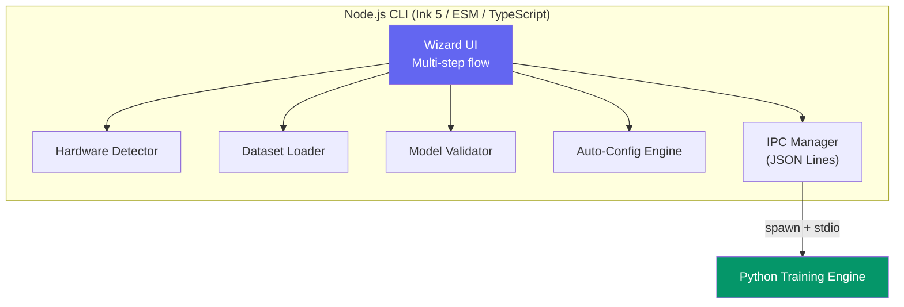
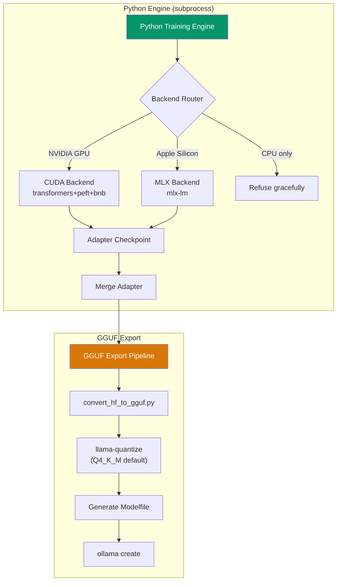

# Orb

Orb is a cross-platform CLI tool that lets you fine-tune an open-weight LLM on your own hardware using QLoRA, and export the result as a ready-to-run GGUF model that drops right into Ollama.

## How to Download & Run

Orb is distributed via npm. You can run it directly without installing, or install it globally:

### Option 1: Run instantly via npx (Recommended)
```bash
npx orb
```

### Option 2: Install globally
```bash
npm install -g orb
orb
```
*Note: Orb requires Node.js 18 or higher. The Python dependencies and environment are handled automatically during the first run.*

## Architecture Overview

Orb is split into two halves: a Node.js wizard CLI for a seamless user experience, and a Python engine that does the heavy lifting for training.



## How the Python Engine Works

The Python engine operates as a subprocess of the Node CLI, ensuring the user interface remains responsive. It never communicates via raw prints, but instead uses a strict JSON Lines (IPC) protocol over `stdout`.



### Engine Workflow:
1. **Backend Routing:** It reads the configuration and hardware detection results, routing the workload to either the `CUDA` backend (NVIDIA) or `MLX` backend (Apple Silicon).
2. **LoRA Injection:** It loads the target model in 4-bit quantization (using `bitsandbytes` on NVIDIA or native MLX on Apple) and injects trainable LoRA adapters (`all-linear` targeting ~1% of base parameters).
3. **Training Loop:** A custom training loop processes the tokenized dataset, feeding progress (loss, tokens/sec, ETA) back to the Node CLI via JSON Lines.
4. **Adapter Merging:** Once training concludes, it loads the FP16 base model, merges the LoRA adapter weights, and exports a unified `safetensors` file.
5. **GGUF Export:** It utilizes `llama-cpp-python` bindings (`convert_hf_to_gguf.py` and `llama-quantize`) to export the merged model directly into a Q4_K_M GGUF file and pushes it to Ollama.

## Fine-Tuning Performance & Analyzed Data

During the testing of Orb, the Python engine demonstrated highly efficient QLoRA fine-tuning. Below is the analyzed data from a test run:

### Test Environment
- **Model:** `TinyLlama/TinyLlama-1.1B-Chat-v1.0`
- **Hardware:** NVIDIA RTX 5050 (using the `cuda` backend)
- **Quantization:** NF4 (4-bit via `bitsandbytes`)
- **Dataset:** JSON Lines conversational format (15 examples, batch size 1)

### Execution Metrics
- **Trainable Parameters:** 6,307,840 (approx. 1.01% of the 621.9M base parameters)
- **Total Steps:** 42 steps (3 epochs over 14 training examples)
- **Memory Footprint:** Loaded flawlessly in 4-bit, avoiding OOM on consumer GPUs.

### Loss Trajectory
The engine successfully converged on the dataset. The loss dropped significantly during training:
- **Step 1:** Loss 2.6950
- **Step 10:** Loss 2.6051
- **Step 15:** Loss 1.8005
- **Step 22:** Loss 0.5113
- **Step 37:** Loss 0.4303

*Observation:* Orb's training loop brought the loss down from ~2.7 to ~0.43 over just 42 steps, demonstrating stable convergence on the toy dataset. 

### Final Output
Following the 42 steps, Orb successfully exported the LoRA weights, merged them into the base model (producing a ~2.2GB FP16 `model.safetensors`), and generated the required artifacts (`config.json`, `chat_template.jinja`, etc.) without dropping the IPC connection.

## System Requirements
- **OS:** Windows, macOS, or Linux
- **Node.js:** v18.0.0 or newer
- **Hardware:** An NVIDIA GPU (with CUDA support) OR an Apple Silicon Mac (M1/M2/M3/M4 series).
- **Disk Space:** Sufficient disk space to download the base HuggingFace model and store the exported GGUF file.

---
*Built to make local AI fine-tuning accessible to everyone.*
