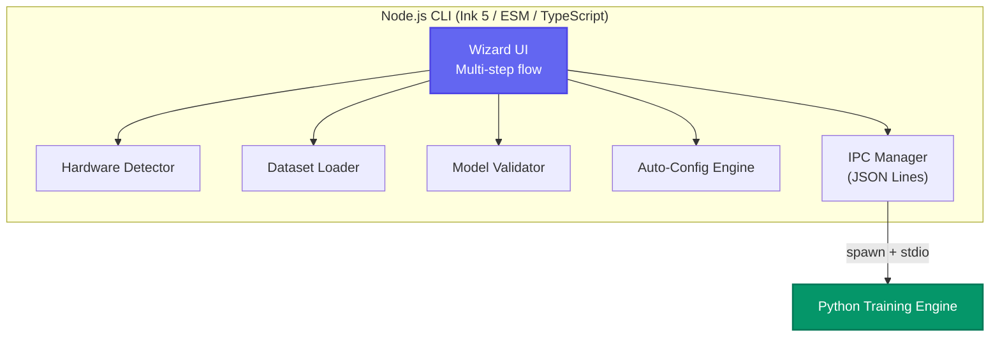
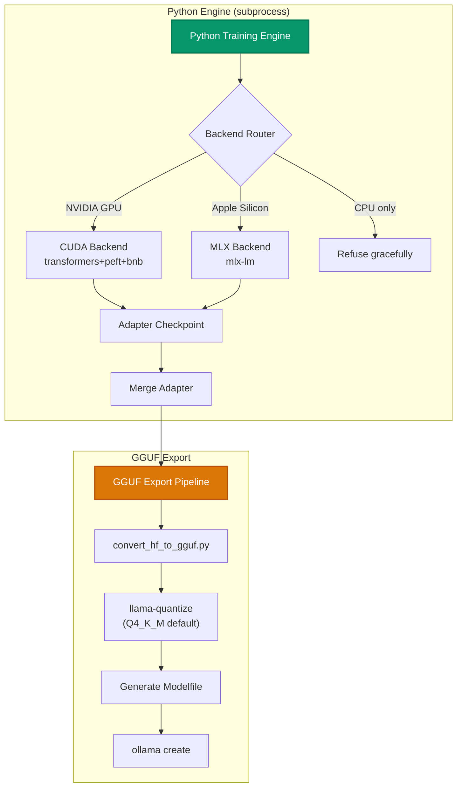

<div align="center">
  
# 🔮 Orb
**The ultimate cross-platform CLI for local LLM fine-tuning.**

[](https://nodejs.org/)
[](https://www.python.org/)
[]()
[]()

*Fine-tune open-weight LLMs on your own hardware using QLoRA, and export ready-to-run GGUF models directly into Ollama.*
</div>

---

## 📑 Table of Contents
- [✨ Features](#-features)
- [🚀 Quick Start](#-quick-start)
- [💻 System Requirements](#-system-requirements)
- [🧠 How It Works: Architecture](#-how-it-works-architecture)
- [⚙️ Python Engine Deep Dive](#️-python-engine-deep-dive)
- [📊 Performance & Analyzed Data](#-performance--analyzed-data)

---

## ✨ Features
- **Cross-Platform:** Works seamlessly on Windows, macOS, and Linux.
- **Hardware Agnostic:** Automatically utilizes NVIDIA CUDA or Apple Silicon (MLX).
- **Interactive UI:** Step-by-step CLI wizard powered by Ink.
- **Zero Configuration:** Auto-configures hyperparameters based on your hardware constraints.
- **Kaggle & Hugging Face Datasets:** Fetch custom datasets directly from Hugging Face or download public/private Kaggle datasets via URLs or dataset slugs.
- **Ollama Ready:** Merges LoRA adapters and exports directly to a Q4_K_M GGUF format that automatically registers with your local Ollama instance.

---

## 🚀 Quick Start

Orb is distributed via npm. You can run it instantly or install it globally for regular use.

> [!TIP]
> **Zero Setup:** The Python dependencies and environment are handled automatically during the first run. Just ensure you have Node.js installed!

### Option 1: Run instantly via npx (Recommended)
```bash
npx orb-finetune
```

### Option 2: Install globally
```bash
npm install -g orb-finetune
orb
```

---

## 💻 System Requirements

| Requirement | Specification |
|-------------|---------------|
| **OS** | Windows, macOS, or Linux |
| **Runtime** | Node.js v18.0.0 or higher |
| **GPU (NVIDIA)** | CUDA Toolkit supported GPU (e.g., RTX series) |
| **GPU (Apple)** | Apple Silicon Mac (M1/M2/M3/M4 series) |
| **Storage** | Sufficient free space for base HF models + exported GGUF files |

---

## 🧠 How It Works: Architecture

Orb is intelligently split into two halves: a Node.js wizard CLI for a seamless, interactive user experience, and a Python training engine that handles the heavy mathematical lifting securely in the background.



---

## ⚙️ Python Engine Deep Dive

The Python engine operates as an isolated subprocess of the Node CLI. This ensures the user interface remains completely responsive. Instead of communicating via messy standard console outputs, it uses a strict **JSON Lines (IPC) protocol** over `stdout`.



### 🔄 Engine Workflow Breakdown

1. 🔀 **Backend Routing:** Reads the hardware detection results and dynamically routes the workload to either the `CUDA` backend (NVIDIA) or the `MLX` backend (Apple Silicon).
2. 💉 **LoRA Injection:** Loads the target model in **4-bit quantization** (using `bitsandbytes` on NVIDIA or native MLX on Apple) and injects trainable LoRA adapters targeting the `all-linear` modules (approx. 1% of base parameters).
3. 🏃‍♂️ **Training Loop:** A highly-optimized custom training loop processes your tokenized dataset. Progress events (loss, tokens/sec, ETA) are streamed back to the Node CLI via JSON Lines.
4. 🧩 **Adapter Merging:** Once training concludes, it reloads the base model in FP16, seamlessly merges the new LoRA adapter weights, and exports a unified `safetensors` model.
5. 📦 **GGUF Export:** Utilizes the robust `llama-cpp-python` bindings (`convert_hf_to_gguf.py` and `llama-quantize`) to instantly export your merged model into a highly efficient **Q4_K_M GGUF** file, pushing it automatically to Ollama.

---

## 📊 Performance & Analyzed Data

During our initial testing phases, Orb's Python engine demonstrated extremely efficient QLoRA fine-tuning. Below is the exact analyzed data collected from a controlled test run.

### 🧪 Test Environment
> **Model:** `TinyLlama/TinyLlama-1.1B-Chat-v1.0` <br>
> **Hardware:** NVIDIA RTX 5050 (`cuda` backend) <br>
> **Quantization:** NF4 (4-bit via `bitsandbytes`) <br>
> **Dataset:** 15 conversational examples (JSON Lines format)

### 📈 Execution Metrics
| Metric | Result |
|--------|--------|
| **Trainable Parameters** | `6,307,840` *(~1.01% of 621.9M total)* |
| **Total Steps** | `42` steps *(3 epochs over 14 train examples, batch size 1)* |
| **Memory Footprint** | Handled seamlessly in 4-bit, averting OOM crashes. |

### 📉 Loss Trajectory
Orb successfully and rapidly converged on the dataset. The loss trajectory highlights stable convergence:

- **Step 1:** `2.6950`
- **Step 10:** `2.6051`
- **Step 15:** `1.8005`
- **Step 22:** `0.5113`
- **Step 37:** `0.4303`

> [!NOTE]
> **Observation:** Orb's training loop aggressively optimized the model, dropping the loss from ~2.70 down to ~0.43 over a mere 42 steps.

### 🎉 Final Output
Following the training, Orb exported the LoRA weights and merged them successfully into the base model. This produced an optimized **~2.2GB FP16 `model.safetensors`** along with all necessary artifacts (`config.json`, `chat_template.jinja`, etc.)—all while maintaining perfect IPC connection stability.

---

<div align="center">
  <i>Built with ❤️ to make local AI fine-tuning accessible to everyone.</i>
</div>
